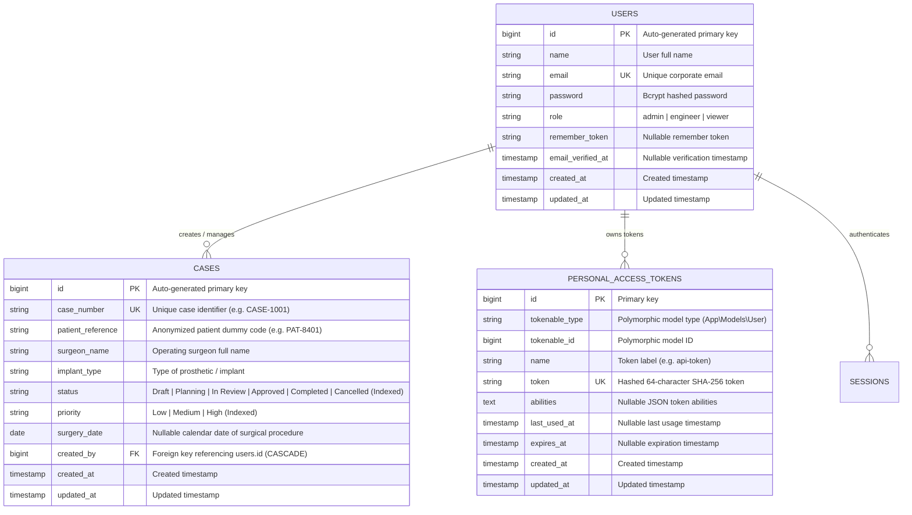

# Database Architecture & Entity Relationships

## Overview
The Medical Case Management database is designed for strict traceability, audit compliance, and fast indexed lookups across surgical implants.

---

## Entity Relationship (ER) Diagram

---

## Table Specifications

### 1. `users`
Stores authorized clinical personnel and platform operators.

| Column | Data Type | Nullable | Index / Key | Description |
| :--- | :--- | :---: | :---: | :--- |
| `id` | `BIGINT UNSIGNED` | No | Primary Key | Auto-incrementing identifier |
| `name` | `VARCHAR(255)` | No | None | Full legal or clinical name |
| `email` | `VARCHAR(255)` | No | Unique Index | Corporate login email address |
| `password` | `VARCHAR(255)` | No | None | Bcrypt hashed password |
| `role` | `VARCHAR(50)` | No | Default: `'viewer'` | User authorization role: `admin`, `engineer`, `viewer` |
| `remember_token`| `VARCHAR(100)` | Yes | None | Web session persistence token |
| `email_verified_at` | `TIMESTAMP` | Yes | None | Optional verification timestamp |
| `created_at` | `TIMESTAMP` | Yes | None | Laravel standard creation timestamp |
| `updated_at` | `TIMESTAMP` | Yes | None | Laravel standard update timestamp |

---

### 2. `cases`
Stores patient implant case definitions, surgical schedules, and lifecycle states.

| Column | Data Type | Nullable | Index / Key | Description |
| :--- | :--- | :---: | :---: | :--- |
| `id` | `BIGINT UNSIGNED` | No | Primary Key | Auto-incrementing identifier |
| `case_number` | `VARCHAR(50)` | No | **Unique Index** | Unique identifier (e.g. `CASE-1001`) |
| `patient_reference` | `VARCHAR(50)` | No | None | Anonymized patient code (e.g. `PAT-8401`) |
| `surgeon_name` | `VARCHAR(100)` | No | None | Lead orthopedic/trauma surgeon name |
| `implant_type` | `VARCHAR(100)` | No | None | Device description (e.g. Titanium Cranial Plate) |
| `status` | `VARCHAR(50)` | No | **Index** | `Draft`, `Planning`, `In Review`, `Approved`, `Completed`, `Cancelled` |
| `priority` | `VARCHAR(20)` | No | **Index** | `Low`, `Medium`, `High` (default: `'Medium'`) |
| `surgery_date` | `DATE` | Yes | None | Scheduled surgery calendar date (`YYYY-MM-DD`) |
| `created_by` | `BIGINT UNSIGNED` | No | **Foreign Key** | References `users.id` with `ON DELETE CASCADE` |
| `created_at` | `TIMESTAMP` | Yes | None | Record creation timestamp |
| `updated_at` | `TIMESTAMP` | Yes | None | Record update timestamp |

---

### 3. Supporting Tables
- `personal_access_tokens`: Laravel Sanctum authentication tokens for REST API clients.
- `sessions`: Secure encrypted server-side session persistence.
- `cache` & `cache_locks`: In-memory and database caching layer (caches Nager.Date holiday API responses).
- `jobs` & `failed_jobs`: Asynchronous queue execution tables.

---

## Indexing Strategy & Performance Rationale

1. **`cases.case_number` (Unique Index)**:
   - Eliminates duplicate implant registry entries at the database level.
   - Provides $O(1)$ constant time lookup for case number searches and API retrieval.

2. **`cases.status` (Index)**:
   - Optimizes dashboard counting queries (`COUNT(*) WHERE status = ?`) and catalog filtering.

3. **`cases.priority` (Index)**:
   - Supports efficient composite and standalone priority filtering.

4. **`cases.created_by` (Foreign Key Index)**:
   - Enforces referential integrity with cascading constraints.
